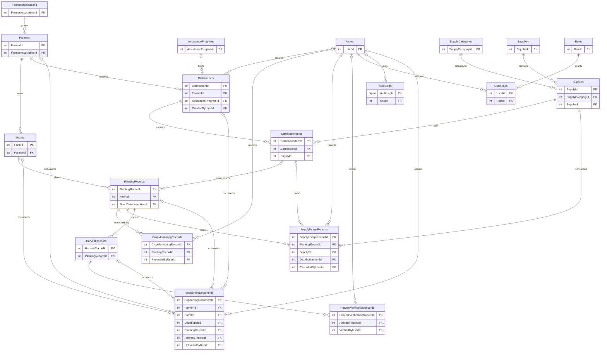

# RISE Database Documentation

## Overview

- **Database:** `RISE_DB`
- **DBMS:** Microsoft SQL Server
- **Application data access:** ASP.NET Core Web API with Entity Framework Core
- **Authoritative table schema:** EF Core migrations in `RISE.API/Migrations`
- **SSMS deployment script:** `RISE_Database.sql`, generated from those migrations

`RISE_Database.sql` is an ordered, complete schema script for a new, empty
database, generated from the EF migrations. It creates `RISE_DB` if absent.
Do not run it against an existing database: SQL Server may compile historical
migration statements against the current schema, and the script is not an
upgrade mechanism. Update an existing database with `dotnet ef database update`,
which consults migration history and preserves existing records. Back up the
database before applying any schema change.

The current application exposes five active modules: Dashboard, Farmer Records,
Assistance Distribution, Utilization Monitoring, and Reports and Analytics.
Historical schema objects remain in place where removing them could break
existing foreign keys or destroy records. The active workflow does not use
separate supplier or warehouse inventory processes.

## Tables and columns

`IDENTITY` columns are generated by SQL Server. Unless marked otherwise,
columns are `NOT NULL`. FK columns reference the key indicated in the
relationships section.

### `Farmers`

Registered farmer profile and status.

| Column | SQL type / nullability | Key, default, and meaning |
|---|---|---|
| `FarmerId` | `int` | PK, identity. |
| `FullName` | `nvarchar(150)` | Farmer's registered full name. |
| `ContactNumber` | `nvarchar(30)` | Farmer's contact number. |
| `Address` | `nvarchar(300)` | Farmer's address. |
| `Barangay` | `nvarchar(100) NULL` | Barangay used for location filters. |
| `Municipality` | `nvarchar(100) NULL` | Municipality used for location filters and reports. |
| `FarmerAssociationId` | `int NULL` | FK to `FarmerAssociations`; a farmer may have no association. |
| `IsActive` | `bit`, default `1` | Soft-archive flag; archived records remain available. |

Filtered unique index on active `(FullName, ContactNumber)` prevents duplicate
active registrations. Other indexes support name, location, association, and
active-state lookups.

### `FarmerAssociations`

Normalized association names shared by farmer records.

| Column | SQL type / nullability | Key, default, and meaning |
|---|---|---|
| `FarmerAssociationId` | `int` | PK, identity. |
| `Name` | `nvarchar(150)` | Unique association name. |

### `Farms`

Land parcels recorded for a farmer.

| Column | SQL type / nullability | Key, default, and meaning |
|---|---|---|
| `FarmId` | `int` | PK, identity. |
| `FarmerId` | `int` | FK to `Farmers`. |
| `Name` | `nvarchar(150)` | Farm name. |
| `Barangay` | `nvarchar(100)` | Farm barangay. |
| `Municipality` | `nvarchar(100)` | Farm municipality. |
| `AreaHectares` | `decimal(12,4)` | Must be greater than zero. |
| `SoilType` | `nvarchar(100) NULL` | Optional soil description. |
| `IsActive` | `bit`, default `1` | Farm active/archive status. |

### `AssistancePrograms`

Government or agricultural assistance program catalog.

| Column | SQL type / nullability | Key, default, and meaning |
|---|---|---|
| `AssistanceProgramId` | `int` | PK, identity. |
| `Name` | `nvarchar(200)` | Unique program name. |
| `Description` | `nvarchar(2000) NULL` | Optional program details. |
| `StartDate` | `date` | Program start date. |
| `EndDate` | `date NULL` | Optional end date; cannot precede `StartDate`. |
| `IsActive` | `bit`, default `1` | Program active/archive status. |

### `SupplyCategories`

Lookup catalog for seeds, fertilizers, crop protection, tools, and similar
inventory categories.

| Column | SQL type / nullability | Key, default, and meaning |
|---|---|---|
| `SupplyCategoryId` | `int` | PK, identity. |
| `Name` | `nvarchar(100)` | Unique category name. |
| `Description` | `nvarchar(500) NULL` | Optional category description. |

### `Suppliers`

Organizations supplying agricultural goods.

| Column | SQL type / nullability | Key, default, and meaning |
|---|---|---|
| `SupplierId` | `int` | PK, identity. |
| `Name` | `nvarchar(200)` | Supplier name. |
| `ContactPerson` | `nvarchar(150) NULL` | Optional supplier contact. |
| `PhoneNumber` | `nvarchar(30) NULL` | Optional phone number. |
| `Email` | `nvarchar(254) NULL` | Optional email address. |
| `Address` | `nvarchar(500) NULL` | Optional supplier address. |
| `IsActive` | `bit`, default `1` | Supplier active/archive status. |

### `Supplies`

Inventory item catalog and current central stock balance.

| Column | SQL type / nullability | Key, default, and meaning |
|---|---|---|
| `SupplyId` | `int` | PK, identity. |
| `SupplyCategoryId` | `int` | FK to `SupplyCategories`. |
| `SupplierId` | `int` | FK to `Suppliers`. |
| `Code` | `nvarchar(50)` | Unique supply code. |
| `Name` | `nvarchar(200)` | Supply name. |
| `UnitOfMeasure` | `nvarchar(30)` | Unit used for stock and distribution quantities. |
| `UnitCost` | `decimal(18,2)` | Must be zero or greater. |
| `StockQuantity` | `decimal(18,3)` | Central stock; must be zero or greater. |
| `IsActive` | `bit`, default `1` | Supply active/archive status. |

### `Distributions`

One assistance or supply distribution to a farmer.

| Column | SQL type / nullability | Key, default, and meaning |
|---|---|---|
| `DistributionId` | `int` | PK, identity. |
| `FarmerId` | `int` | FK to `Farmers`. |
| `AssistanceProgramId` | `int NULL` | Optional FK to `AssistancePrograms`. |
| `CreatedByUserId` | `int NULL` | Optional FK to `Users`. |
| `ReferenceNumber` | `nvarchar(80) NULL` | Optional unique distribution reference. |
| `DistributionDate` | `date` | Distribution date; set to confirmation date by the procedure. |
| `Status` | `nvarchar(20)`, default `Draft` | Check-constrained to `Draft`, `Approved`, `Distributed`, or `Cancelled`. |
| `Notes` | `nvarchar(2000) NULL` | Optional distribution notes. |
| `CreatedAtUtc` | `datetime2`, default `SYSUTCDATETIME()` | Creation timestamp in UTC. |

### `DistributionItems`

Supply line items in a distribution.

| Column | SQL type / nullability | Key, default, and meaning |
|---|---|---|
| `DistributionItemId` | `int` | PK, identity. |
| `DistributionId` | `int` | FK to `Distributions`. |
| `SupplyId` | `int` | FK to `Supplies`. |
| `Quantity` | `decimal(18,3)` | Must be greater than zero. |
| `UnitCost` | `decimal(18,2)` | Cost captured at distribution time; zero or greater. |
| `LotNumber` | `nvarchar(100) NULL` | Optional supply lot/batch number. |

Unique `(DistributionId, SupplyId)` index allows one line per supply on a
distribution.

### `PlantingRecords`

Planting activity on a registered farm, optionally linked to distributed seed.

| Column | SQL type / nullability | Key, default, and meaning |
|---|---|---|
| `PlantingRecordId` | `int` | PK, identity. |
| `FarmId` | `int` | FK to `Farms`. |
| `SeedDistributionItemId` | `int NULL` | Optional FK to the distributed seed line. |
| `CropName` | `nvarchar(100)`, default `Rice` | Crop planted. |
| `Variety` | `nvarchar(100) NULL` | Optional crop variety. |
| `Season` | `nvarchar(50) NULL` | Optional agricultural season label. |
| `PlantingDate` | `date` | Planting date. |
| `AreaPlantedHectares` | `decimal(12,4)` | Must be greater than zero. |
| `ExpectedHarvestDate` | `date NULL` | Optional expected date; cannot precede planting date. |
| `Status` | `nvarchar(20)`, default `Growing` | Check-constrained to `Growing`, `Harvested`, `Failed`, or `Cancelled`. |

### `CropMonitoringRecords`

Time-stamped crop observations associated with a planting record.

| Column | SQL type / nullability | Key, default, and meaning |
|---|---|---|
| `CropMonitoringRecordId` | `int` | PK, identity. |
| `PlantingRecordId` | `int` | FK to `PlantingRecords`. |
| `RecordedByUserId` | `int NULL` | Optional FK to `Users`. |
| `ObservedAtUtc` | `datetime2`, default `SYSUTCDATETIME()` | Observation timestamp in UTC. |
| `GrowthStage` | `nvarchar(100)` | Observed growth stage. |
| `CropHealth` | `nvarchar(100) NULL` | Optional crop-health description. |
| `PestOrDisease` | `nvarchar(500) NULL` | Optional pest/disease observations. |
| `RainfallMillimeters` | `decimal(10,2) NULL` | Optional rainfall; zero or greater. |
| `Notes` | `nvarchar(2000) NULL` | Optional field notes. |

### `SupplyUsageRecords`

Supply application records for a crop, optionally traced to a distribution line.

| Column | SQL type / nullability | Key, default, and meaning |
|---|---|---|
| `SupplyUsageRecordId` | `int` | PK, identity. |
| `PlantingRecordId` | `int` | FK to `PlantingRecords`. |
| `SupplyId` | `int` | FK to `Supplies`. |
| `DistributionItemId` | `int NULL` | Optional FK to the supplied distribution line. |
| `RecordedByUserId` | `int NULL` | Optional FK to `Users`. |
| `UsageDate` | `date` | Date the supply was used. |
| `QuantityUsed` | `decimal(18,3)` | Must be greater than zero. |
| `Notes` | `nvarchar(2000) NULL` | Optional application notes. |

Usage recording does not decrement central stock: stock is reduced when a
distribution is confirmed, avoiding double-counting distributed supplies.

### `HarvestRecords`

Measured crop yield for a planting record.

| Column | SQL type / nullability | Key, default, and meaning |
|---|---|---|
| `HarvestRecordId` | `int` | PK, identity. |
| `PlantingRecordId` | `int` | FK to `PlantingRecords`. |
| `HarvestDate` | `date` | Harvest date. |
| `QuantityKilograms` | `decimal(18,3)` | Harvest amount; greater than zero. |
| `MoisturePercent` | `decimal(5,2) NULL` | Optional moisture from 0 to 100 percent. |
| `Grade` | `nvarchar(50) NULL` | Optional harvest grade. |
| `Notes` | `nvarchar(2000) NULL` | Optional harvest notes. |

### `HarvestVerificationRecords`

Verification decisions and measurements for harvest records.

| Column | SQL type / nullability | Key, default, and meaning |
|---|---|---|
| `HarvestVerificationRecordId` | `int` | PK, identity. |
| `HarvestRecordId` | `int` | FK to `HarvestRecords`. |
| `VerifiedByUserId` | `int NULL` | Optional FK to `Users`. |
| `VerifiedAtUtc` | `datetime2`, default `SYSUTCDATETIME()` | Verification timestamp in UTC. |
| `VerifiedQuantityKilograms` | `decimal(18,3) NULL` | Optional verified quantity; zero or greater. |
| `Status` | `nvarchar(20)`, default `Pending` | Check-constrained to `Pending`, `Verified`, or `Rejected`. |
| `Remarks` | `nvarchar(2000) NULL` | Optional verifier notes. |

### `Users`

Application account identity data. Passwords must be stored as application-
generated hashes, never plaintext.

| Column | SQL type / nullability | Key, default, and meaning |
|---|---|---|
| `UserId` | `int` | PK, identity. |
| `UserName` | `nvarchar(100)` | Unique login name. |
| `Email` | `nvarchar(254)` | Unique email address. |
| `DisplayName` | `nvarchar(150)` | Name shown in application records. |
| `PasswordHash` | `nvarchar(500)` | Password hash only. |
| `IsActive` | `bit`, default `1` | Account active/archive status. |
| `CreatedAtUtc` | `datetime2`, default `SYSUTCDATETIME()` | Account creation time in UTC. |

### `Roles`

Application role catalog.

| Column | SQL type / nullability | Key, default, and meaning |
|---|---|---|
| `RoleId` | `int` | PK, identity. |
| `Name` | `nvarchar(100)` | Unique role name. |
| `Description` | `nvarchar(500) NULL` | Optional role description. |

### `UserRoles`

Many-to-many user/role junction table.

| Column | SQL type / nullability | Key, default, and meaning |
|---|---|---|
| `UserId` | `int` | Composite PK; FK to `Users`. |
| `RoleId` | `int` | Composite PK; FK to `Roles`. |
| `AssignedAtUtc` | `datetime2`, default `SYSUTCDATETIME()` | Role assignment timestamp in UTC. |

### `AuditLogs`

Append-oriented record of selected system operations.

| Column | SQL type / nullability | Key, default, and meaning |
|---|---|---|
| `AuditLogId` | `bigint` | PK, identity. |
| `UserId` | `int NULL` | Optional FK to `Users`; null for system operations. |
| `Action` | `nvarchar(50)` | Action name. |
| `EntityName` | `nvarchar(150)` | Affected entity/table name. |
| `EntityId` | `nvarchar(100) NULL` | Affected record key as text. |
| `OccurredAtUtc` | `datetime2`, default `SYSUTCDATETIME()` | Event timestamp in UTC. |
| `OldValuesJson` | `nvarchar(max) NULL` | Optional before-state JSON. |
| `NewValuesJson` | `nvarchar(max) NULL` | Optional after-state JSON. |
| `IpAddress` | `nvarchar(45) NULL` | Optional IPv4/IPv6 address. |

### `SupportingDocuments`

Document metadata and protected storage path. File contents are not stored in
SQL Server or a public web folder. Exactly one parent record must be supplied.

| Column | SQL type / nullability | Key, default, and meaning |
|---|---|---|
| `SupportingDocumentId` | `int` | PK, identity. |
| `FarmerId` | `int NULL` | Optional FK to `Farmers`; one of the five parent FKs. |
| `FarmId` | `int NULL` | Optional FK to `Farms`; one of the five parent FKs. |
| `DistributionId` | `int NULL` | Optional FK to `Distributions`; one of the five parent FKs. |
| `PlantingRecordId` | `int NULL` | Optional FK to `PlantingRecords`; one of the five parent FKs. |
| `HarvestRecordId` | `int NULL` | Optional FK to `HarvestRecords`; one of the five parent FKs. |
| `UploadedByUserId` | `int NULL` | Optional FK to `Users`. |
| `FileName` | `nvarchar(255)` | Original file name. |
| `StoragePath` | `nvarchar(1000)` | Protected storage location, not a public URL. |
| `ContentType` | `nvarchar(150)` | MIME content type. |
| `FileSizeBytes` | `bigint` | Must be zero or greater. |
| `Sha256` | `nvarchar(64) NULL` | Optional SHA-256 integrity digest. |
| `UploadedAtUtc` | `datetime2`, default `SYSUTCDATETIME()` | Upload time in UTC. |

## Relationships and keys

- `FarmerAssociations` 1-to-many `Farmers`; each farmer can have zero or one
  association.
- `Farmers` 1-to-many `Farms` and 1-to-many `Distributions`.
- `AssistancePrograms` 1-to-many `Distributions`; a distribution's program is
  optional.
- `SupplyCategories` and `Suppliers` each 1-to-many `Supplies`.
- `Distributions` 1-to-many `DistributionItems`; `Supplies` 1-to-many
  `DistributionItems`.
- `Farms` 1-to-many `PlantingRecords`; a planting may reference a seed
  `DistributionItem`.
- `PlantingRecords` 1-to-many `CropMonitoringRecords`,
  `SupplyUsageRecords`, and `HarvestRecords`.
- `HarvestRecords` 1-to-many `HarvestVerificationRecords`.
- `Users` and `Roles` are many-to-many through `UserRoles`.
- Users optionally author distributions, crop observations, supply usage,
  harvest verifications, audit events, and document uploads.
- A supporting document references exactly one of farmer, farm, distribution,
  planting, or harvest, enforced by a SQL CHECK constraint.
- All relationships use restrictive deletion so history cannot be removed by
  deleting a parent row.

In the diagram, `o|` marks an optional relationship; the supporting-document
CHECK constraint requires exactly one of its five parent foreign keys to be
populated.

The database has primary keys for every entity, 29 foreign keys, enabled and
trusted check constraints, unique indexes for natural keys, and indexes on
relationship/date/search columns. See the migration snapshot and SQL Server
catalogs for the exact deployed definitions.

## Normalization notes

- Association, supply category, supplier, assistance program, and role names
  are stored once in lookup tables.
- `DistributionItems` separates distribution headers from their supply lines.
- `UserRoles` models the many-to-many role assignment without repeating user
  or role data.
- Planting, monitoring, usage, harvest, and verification records are separated
  to preserve the agricultural lifecycle and its history.
- Document bytes are external; the relational row stores metadata and exactly
  one owning record.
- The current farm model assigns each farm to one farmer; avoid duplicating
  farmer identity on planting records because it is available through the farm.

## Open and manage the database in SSMS

1. Connect to the SQL Server instance configured in
   `RISE.API/appsettings.json`. That file uses Windows integrated
   authentication; do not commit credentials.
2. Select `RISE_DB` in Object Explorer. Expand **Tables**, **Views**,
   **Programmability > Stored Procedures**, and **Keys** to inspect objects.
3. For a new, empty database only, open `RISE_Database.sql` in SSMS and select
   **Execute**. It creates the database and applies the complete migration
   chain. Do not execute it against the existing project database.
4. For a fresh database, run scripts in this order:
   `RISE_Database.sql`, `RISE_Stored_Procedures.sql`, `RISE_Views.sql`,
   `RISE_Sample_Data.sql` (optional).
5. To retain sample rows, review `RISE_Sample_Data.sql` and change its final
   `ROLLBACK TRANSACTION` to `COMMIT TRANSACTION` only in a development
   database. It rolls back by default.
6. Use `RISE_CRUD_Queries.sql` for read examples, rollback-safe data mutations,
   and an `ALTER TABLE` example on a session-local temporary table. Make
   production schema changes via EF migrations, then regenerate
   `RISE_Database.sql`.

The project connection string currently targets `ASLI\SQLEXPRESS` and
`RISE_DB`. `dotnet ef database update` from `RISE.API` is the standard,
migration-aware schema update command for existing and newly created
application databases.

## Current scope

The frontend and API currently provide farmer management. The remaining tables
are ready for future API/UI phases. Settings and notifications are intentionally
not represented by tables until their behavior and data requirements are
implemented. User accounts have storage fields and role relationships, but
authentication, authorization policies, and account-management endpoints are
not part of this database deliverable.

## Utilization monitoring enhancement

The EF Core migration `20261119150000_UtilizationMonitoring` adds `UtilizationMonitorings`, linked one-to-one to `DistributionItems`. The four nullable quantity columns preserve the distinction between zero and not yet reported. Application validation prevents negative quantities and prevents the reported total from exceeding the associated received quantity. Unreported quantity is derived as received quantity minus the sum of reported categories.
